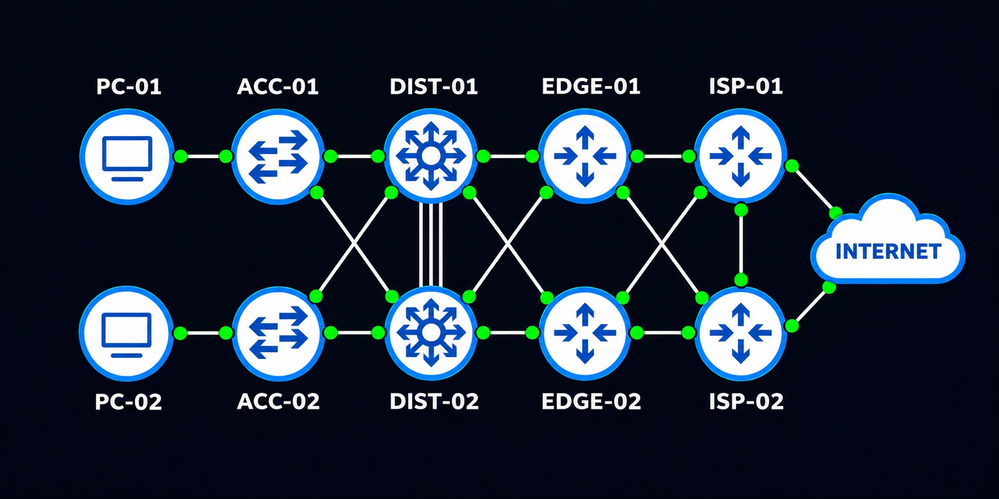

# Enterprise Campus Network

**Two-tier campus networking, redundant edge routing, dual-ISP BGP, and NAT/PAT in GNS3**

A Cisco networking lab I built to practice designing, configuring, and troubleshooting a small enterprise campus.

## Overview

The two-tier campus uses Layer 2 access switches and Layer 3 distribution switches. Distribution provides HSRP gateways, a three-link LACP Port-channel and four routed OSPF links to the enterprise edges. EDGE-01 retains the campus DHCP pools for VLANs 10, 20 and 90.

Both edge routers connect to two simulated ISPs through four eBGP sessions within Enterprise AS 65000. The network also implements iBGP, BGP local preference to prioritize ISP-01, and NAT/PAT for Internet connectivity.

## Network topology



A two-tier campus design with redundant uplinks, a three-link LACP EtherChannel, dual-multihomed ISP connections, and an inter-ISP peering link.

## Network capabilities

| Capability | Implementation |
| --- | --- |
| VLAN segmentation | VLAN 10 (Users), VLAN 20 (Staff), VLAN 90 (Management) |
| First-hop redundancy | HSRP v2 with distribution switches alternating active roles |
| Link aggregation | Three-link LACP EtherChannel between distribution switches |
| Dynamic routing | OSPF Area 0 between distribution switches and edge routers |
| Spanning Tree | Rapid PVST+ with per-VLAN root placement |
| DHCP | DHCP pools on EDGE-01 and DHCP relay on distribution SVIs |
| Access security | DHCP snooping, Dynamic ARP Inspection, and sticky MAC port security |
| Dual-ISP eBGP | Two enterprise edge routers connected to ISP-01 (AS 65001) and ISP-02 (AS 65002) |
| iBGP and routing policy | Loopback peering, `next-hop-self`, ISP-01 local preference 200, and `10.10.0.0/16` aggregate configuration |
| Internet NAT/PAT | Enterprise-edge NAT/PAT through ISP-01, followed by ISP-01 PAT to the GNS3 Internet |
| Backup ISP path | Secondary eBGP connectivity through ISP-02; ISP-02 NAT/PAT is a future addition |

## Architecture

### Access layer

- `ACC-01` carries the PC in VLAN 10; `ACC-02` carries the PC in VLAN 20.
- Each access switch connects to **both** distribution switches by independent 802.1Q trunks.
- VLAN 90 provides a separate IP subnet for switch management.
- PC-facing ports use port security; DHCP snooping and DAI are configured to protect client traffic.

### Distribution layer

- `DIST-01` and `DIST-02` perform inter-VLAN routing using SVIs.
- HSRP supplies one stable virtual gateway per VLAN, even when the preferred distribution switch changes.
- A three-member LACP Port-channel provides an inter-distribution Layer 2 connection.
- Each distribution switch has a routed OSPF connection to **each** edge router.

### Edge and Internet/WAN

- `EDGE-01` provides the campus DHCP pools and also connects to both simulated ISPs through eBGP.
- `EDGE-02` provides a second routed Internet edge with both ISP connections.
- The two enterprise edges have iBGP configured between `Loopback1` interfaces; OSPF carries the campus and loopback routes.
- ISP-01 (AS 65001) and ISP-02 (AS 65002) peer over `203.0.113.0/30`, and each has a GNS3 NAT-facing interface.
- ISP-01 uses two-stage NAT/PAT to reach the simulated Internet. ISP-02 provides an additional BGP path, with its NAT/PAT configuration reserved for a future expansion.

[Full dual-ISP BGP and NAT design](docs/wan-bgp-nat.md).

See [Architecture and design decisions](docs/architecture.md) for more detail.

## VLAN and IP addressing

| VLAN | Name | IPv4 network | HSRP virtual IP | Preferred active switch |
| ---: | --- | --- | --- | --- |
| 10 | USERS | `10.10.10.0/24` | `10.10.10.254` | `DIST-01` |
| 20 | STAFF | `10.10.20.0/24` | `10.10.20.254` | `DIST-02` |
| 90 | MANAGEMENT | `10.10.90.0/24` | `10.10.90.254` | `DIST-01` |
| 999 | BLACKHOLE / native | No routed SVI | None | Not applicable |

Distribution SVI addresses use `.1` on `DIST-01` and `.2` on `DIST-02` for VLANs 10, 20, and 90. The addressing plan assigns `10.10.90.11` and `10.10.90.12` to the access switches.

See [Full addressing plan](docs/ip-addressing.md) for physical routed links, management addresses, and gateway choices.

The WAN design uses four ISP /30s and an ISP-to-ISP link (`203.0.113.0/30`). [View the WAN addressing table](docs/wan-bgp-nat.md#wan-addressing-and-bgp-neighbors).

## How redundancy works

**HSRP:** VLANs 10 and 90 prefer `DIST-01`; VLAN 20 prefers `DIST-02`. End devices keep `.254` as their default gateway, even if the active router changes.

**LACP:** Three inter-distribution links form one logical Port-channel, providing link-level redundancy.

**Rapid PVST+:** Spanning Tree prevents Layer 2 loops across redundant access uplinks. The per-VLAN root bridge design aligns with HSRP gateway roles.

**OSPF:** Four routed distribution-to-edge links provide multiple paths for internal routing.

**Dual-ISP BGP:** Both enterprise edge routers have eBGP connections to each ISP, and the ISPs peer with one another. A BGP route map prefers ISP-01 for default routing. ISP-02 NAT/PAT is not part of the current configuration.

[Redundancy design](docs/redundancy.md)

## Security design

The baseline lab uses VLAN separation, DHCP snooping, Dynamic ARP Inspection, sticky MAC learning, switch management over VLAN 90, and SSH. VLAN separation **does not automatically block routed communication** between VLANs; inter-VLAN ACL policy is not claimed as implemented in these files.

[Access-layer security notes](docs/security.md)

## Configuration references

The published files are **sanitized, consolidated configuration references** drawn from the lab design, rather than exact device running-config backups. There is **one configuration per device**, with BGP and NAT included directly in each edge router file. Campus VLAN 90 and distinct OSPF router IDs are used throughout.

| Access switches | Distribution switches | Edge routers |
| --- | --- | --- |
| [ACC-01](configs/access/ACC-01.cfg) | [DIST-01](configs/distribution/DIST-01.cfg) | [EDGE-01](configs/edge/EDGE-01.cfg) |
| [ACC-02](configs/access/ACC-02.cfg) | [DIST-02](configs/distribution/DIST-02.cfg) | [EDGE-02](configs/edge/EDGE-02.cfg) |

**Simulated ISP configurations:** [ISP-01](configs/wan/ISP-01.cfg) · [ISP-02](configs/wan/ISP-02.cfg)

## Design trade-offs

- **Dual-homed Layer 2 access:** Keeps access switching straightforward but allows STP to place alternate uplinks into discarding state on some VLANs.
- **HSRP with asymmetric active roles:** Distributes gateway ownership across the distribution pair but requires consistent STP root planning.
- **Dual-multihomed WAN:** Provides four enterprise-to-ISP eBGP connections and an inter-ISP link. Full ISP-02 Internet access requires a corresponding NAT/PAT and return-routing design.
- **Consolidated single-site design:** The edge files combine BGP, NAT/PAT, campus VLAN 90, and consistent interface assignments in one reference per device.
- **Separate SRv6 lab:** Keeps campus troubleshooting focused rather than introducing an unfinished WAN transport into every campus test.

More detail: [Design decisions](docs/design-decisions.md).

## Future Development & Learning Goals

This network is an ongoing learning project. As I continue developing my networking skills, I plan to expand the topology and implement additional technologies to better understand enterprise network design, security, and troubleshooting.

### Planned Implementations

- **OSPFv3 & IPv6:** Introduce IPv6 addressing and OSPFv3 routing alongside the existing IPv4 infrastructure.
- **SRv6 Backbone (separate repository):** Develop Segment Routing over IPv6 services for a separate multi-site lab.
- **Rapid PVST+ Optimization:** Fine-tune bridge priorities, root placement, and path selection to improve Layer 2 redundancy and convergence.
- **OSPF Authentication:** Implement routing protocol authentication to protect OSPF adjacencies from unauthorized participation.
- **Multi-Area OSPF:** Explore hierarchical OSPF designs, area border routers, and route summarization if future network expansion justifies multiple areas.
- **HSRP Object Tracking with IP SLA:** Monitor upstream reachability and adjust HSRP priorities when connectivity is lost.
- **Network Monitoring:** Explore centralized Syslog, NTP, and SNMPv3 for device monitoring and troubleshooting.
- **Dual-ISP Failover:** Extend NAT/PAT to ISP-02 and refine routing policies for backup Internet connectivity.
- **BGP Policy Hardening:** Refine the `PREFER-ISP01` route map, outbound prefix filters, and iBGP best-path selection.
- **Redundancy & Convergence:** Explore how STP, HSRP, OSPF, and BGP respond to link and device failures.

### Long-Term Goal

Continue refining this single-site enterprise campus while documenting new implementations, troubleshooting experiences, and lessons learned. Multi-site SRv6 networking will be developed separately.

## Repository contents

```text
Enterprise-Campus-Network/
├── README.md
├── topology/
│   └── campus-topology.png
├── configs/
│   ├── access/
│   ├── distribution/
│   ├── edge/
│   └── wan/
├── docs/
│   ├── architecture.md
│   ├── ip-addressing.md
│   ├── redundancy.md
│   ├── security.md
│   ├── design-decisions.md
│   └── wan-bgp-nat.md
└── notes/
    ├── troubleshooting-log.md
    └── lessons-learned.md
```

[More troubleshooting notes](notes/lessons-learned.md)
