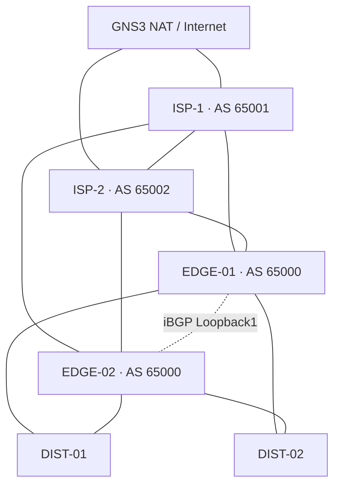

# Dual-ISP BGP and NAT/PAT

[← Back to main README](../README.md)

> **Status:** Consolidated single-site *documentation reference* based on the provided campus and dual-ISP configs. The campus and WAN settings originally came from different lab snapshots. The merged edge references are not verified live running-config exports. ISP-2 Internet failover remains untested.

## Design overview

Two enterprise edge routers in **AS 65000** each have an eBGP connection to **ISP-1 (AS 65001)** and **ISP-2 (AS 65002)**. Both edge routers also use iBGP across Loopback1 addresses. ISP-1 and ISP-2 connect to one another over a separate eBGP link, and both attach to an upstream GNS3 Internet/NAT segment.

The campus distribution layer retains four routed OSPF Area 0 connections to the enterprise edge. This is a **single enterprise site**; separate private multi-site/SRv6 networking is outside this repository.

## WAN addressing and BGP neighbors

| Link | Enterprise end | ISP end | Peering |
| --- | --- | --- | --- |
| EDGE-01 ↔ ISP-1 | Gi0/1 `198.51.100.2/30` | ISP-1 Gi0/1 `198.51.100.1/30` | 65000 ↔ 65001 |
| EDGE-02 ↔ ISP-1 | Gi0/2 `198.51.100.6/30` | ISP-1 Gi0/2 `198.51.100.5/30` | 65000 ↔ 65001 |
| EDGE-01 ↔ ISP-2 | Gi0/2 `192.0.2.6/30` | ISP-2 Gi0/2 `192.0.2.5/30` | 65000 ↔ 65002 |
| EDGE-02 ↔ ISP-2 | Gi0/1 `192.0.2.2/30` | ISP-2 Gi0/1 `192.0.2.1/30` | 65000 ↔ 65002 |
| ISP-1 ↔ ISP-2 | ISP-1 Gi0/3 `203.0.113.1/30` | ISP-2 Gi0/3 `203.0.113.2/30` | 65001 ↔ 65002 |
| Enterprise iBGP | EDGE-01 Lo1 `1.1.1.1/32` | EDGE-02 Lo1 `2.2.2.2/32` | AS 65000 internal |

ISP-1 and ISP-2 Gi0/0 get their external IPv4 addresses via DHCP from GNS3 NAT. The /30 networks used for ISP links are reserved documentation addresses, not public allocations.

## Campus-to-edge links

| Edge interface | IP | Distribution peer |
| --- | --- | --- |
| EDGE-01 Gi0/0 | `10.0.0.2/30` | DIST-01 `10.0.0.1/30` |
| EDGE-01 Gi0/3 | `10.0.0.14/30` | DIST-02 `10.0.0.13/30` |
| EDGE-02 Gi0/0 | `10.0.0.10/30` | DIST-02 `10.0.0.9/30` |
| EDGE-02 Gi0/3 | `10.0.0.6/30` | DIST-01 `10.0.0.5/30` |

Both edges include their loopback and routed campus links in OSPF Area 0. The consolidated reference uses **OSPF router ID 3.3.3.3 on EDGE-01 and 4.4.4.4 on EDGE-02**, preserving the campus numbering and avoiding duplication with the distribution router IDs 1.1.1.1 and 2.2.2.2.

## BGP configuration and policies

The edge configuration includes:

- Four total enterprise-to-ISP eBGP neighbor definitions, two on each edge.
- An iBGP neighbor using `update-source Loopback1` and `next-hop-self`, with the loopbacks advertised in OSPF.
- `network` statements for VLAN 10 (`10.10.10.0/24`), VLAN 20 (`10.10.20.0/24`) and **VLAN 90** (`10.10.90.0/24`), adapted from the previous VLAN 99 WAN snapshot to match the current campus.
- `aggregate-address 10.10.0.0 255.255.0.0 as-set summary-only`, which depends on appropriate more-specific BGP routes and is intended only for a private GNS3 lab.
- An inbound `PREFER-ISP01` route-map on each ISP-1 eBGP neighbor, assigning **LOCAL_PREF 200** to received default routes and permitting other routes through sequence 20.
- Corrected `PREFER-IPS01` typo from the original EDGE-01 running configuration; sequence 20 now belongs to `PREFER-ISP01`.

`ISP-IN` and `ISP-OUT` prefix lists are included as **unattached** references. The provided `ISP-OUT` denies all IPv4 routes; applying it unchanged would block all BGP advertisements. There is currently **no attached outbound BGP filter** in the provided design. Apply explicit prefix policies if extending beyond the isolated lab, and do not advertise `10.10.0.0/16` to real ISPs.

Configured BGP commands alone don't demonstrate neighbor establishment, best-path choice or working failover; capture operational verification before making those claims.

## NAT and Internet paths

| Device | NAT/PAT design | Status |
| --- | --- | --- |
| EDGE-01 | Campus `10.10.0.0/16` via route-map `CAMPUS-NAT-ISP1`, PAT to Gi0/1 | Configured reference based on original EDGE-01 ISP-1 route-map |
| EDGE-02 | Campus `10.10.0.0/16` via route-map `CAMPUS-NAT-ISP1`, PAT to Gi0/2 | Configured reference based on original EDGE-02 ISP-1 route-map |
| ISP-1 | PAT for `198.51.100.0/29` sources to Gi0/0 GNS3 NAT-side address | Configured in supplied ISP-1 running config |
| ISP-2 | NAT/PAT not configured | Client Internet failover via ISP-2 not yet demonstrated |

Both enterprise edge routers have `ip nat inside` on their distribution-facing interfaces and `ip nat outside` on their ISP-facing interfaces. The original NAT ACL `NAT-LAN` and route-map `NAT-ISP1` are renamed `CAMPUS-NAT-LAN` and `CAMPUS-NAT-ISP1` so the site is geographically neutral, with the same matching behavior.

The original campus NAT screenshot documents **the earlier direct-GNS3-NAT EDGE-02 experiment**, not the ISP-1 double-PAT design. Do not treat that screenshot as validation of this integrated WAN.

ISP-2 service still needs corresponding PAT on the edge and ISP as well as controlled packet/route verification. WAN failover can change the translated source address and need not preserve existing sessions.

## Configurations

- [EDGE-01](../configs/edge/EDGE-01.cfg)
- [EDGE-02](../configs/edge/EDGE-02.cfg)
- [ISP-1](../configs/wan/ISP-1.cfg)
- [ISP-2](../configs/wan/ISP-2.cfg)

## Validation checklist

- [ ] `show ip bgp summary`: verify all four eBGP neighbor sessions are Established.
- [ ] Verify iBGP session between `1.1.1.1` and `2.2.2.2`.
- [ ] `show ip route 1.1.1.1` and `show ip route 2.2.2.2`: verify loopback reachability.
- [ ] `show ip bgp 0.0.0.0`: verify ISP-1 default has LOCAL_PREF 200.
- [ ] `show ip ospf neighbor`: verify four distribution-edge adjacencies and unique OSPF router IDs.
- [ ] Check NAT translations from an actual VLAN 10 or 20 client to an external destination via ISP-1.
- [ ] Add and test full ISP-2 NAT/PAT before claiming backup Internet reachability.
- [ ] Shut down the preferred ISP link and record BGP/OSPF route changes and client connectivity.
- [ ] Validate that no unintended private route is advertised toward a public network.
